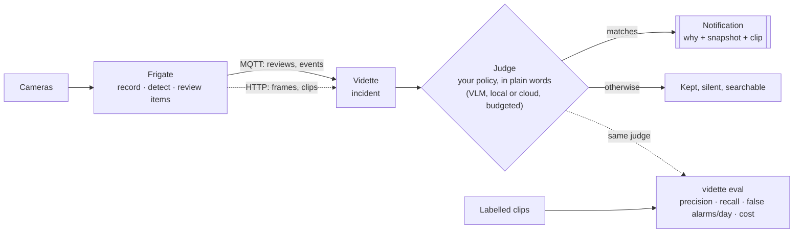

<div align="center">

# Vidette

**Alert policies in plain language, judged on top of Frigate, measured before you trust them.**

*A **vidette** was a mounted sentry posted ahead of the picket line: the first to see
trouble coming, and the one trusted to tell a passing farmer from an approaching threat.*

[](https://github.com/baadev/vidette/releases)
[](LICENSE)
[](https://github.com/baadev/vidette/actions/workflows/ci.yml)

[Status](#status) · [Why](#why) · [How it works](#how-it-works) · [Try it](#try-it) ·
[Roadmap](ROADMAP.md) · [Frigate setup](docs/frigate.md) · [Measuring](docs/eval.md)

</div>

## Status

> **v0.2 is a development line, not a release.** In November 2026 Vidette changed course: it
> no longer tries to be an NVR. [Frigate](https://frigate.video) records, detects and groups
> activity into review items; Vidette reads them and decides, under a policy you wrote in
> plain words, which ones deserve your phone. Why:
> [ADR-0009](docs/architecture/adr/0009-intent-layer-over-frigate.md).
>
> **Works on `v0.2` today**
> - Frigate source: review items and tracked objects over MQTT, snapshots, recording frames
>   and clips over Frigate's HTTP API, all typed and tested on recorded-format fixtures.
> - Every Frigate review item becomes an `observed` event in Vidette's Events page, with
>   Frigate's own severity and GenAI summary shown as Frigate's.
> - `vidette eval`: precision, recall, false alarms per day and VLM cost for a judge on a
>   labelled clip set, with 95 % intervals. Four model-free baselines to beat.
> - `vidette frigate check | tail --record | replay` to inspect a Frigate install.
> - Clip folders as a second incident source, and `vidette collect` to fill one from a
>   battery camera that streams only while awake ([ADR-0010](docs/architecture/adr/0010-clip-folders.md)).
> - The VLM judge, local (Ollama) or cloud (OpenAI, Gemini, OpenRouter), chosen in the
>   config or on the System page: closed incidents become `confirmed` (notifies) or
>   `dismissed` (quiet); `vidette eval` compares both judges side by side, and
>   `vidette label` drafts labels with it for review on a phone. Tested against a fake
>   OpenAI-compatible server only; no real model has judged real footage yet.
>
> **Not yet**
> - A policy shown back as a structured spec, dry runs over past events, calibration from
>   👍/👎, published accuracy numbers.
>
> **No accuracy numbers yet.** The first ones will come from `vidette eval` on a labelled set
> of real clips, with the set's size printed next to them.
>
> The v0.1 NVR (recording, live view, detection cascade, ONVIF) is frozen at tag
> [`nvr-core`](https://github.com/baadev/vidette/tree/nvr-core); v0.1.x images remain
> published and unchanged.

## Why

A camera that sees everything is easy. A notification you do not learn to ignore is hard.
Frigate already finds the person in the frame, and since 0.17 it can describe the scene and
rate a threat level. What you still cannot do is say, in your own words, which situations
should reach you, check how often that rule would have woken you last week, and see the
error rates before you rely on it.

> You tell Vidette:
>
> **"Alert me only when someone looks genuinely interested in getting in. Ignore passers-by,
> couriers, cats and headlights."**
>
> It asks a vision-language model a structured question about the few frames that matter,
> applies your rule, and stays quiet about everything else. And it tells you, with numbers
> from your own clips, how often it gets that right.

That last part is the product as much as the first: a policy you cannot measure is a
vibe, and a security system that runs on vibes gets switched off.

## How it works



- **Frigate does the cheap tiers** (motion, detection, tracking, zones) on hardware it
  already supports. Vidette opens no camera connection and records nothing.
- **Vidette owns the expensive, rare tier**: one judgment per incident, against your
  policy, on a call budget.
- **The judge that runs at home is the one `vidette eval` scores**: same interface, same
  incident type, so offline numbers and live behaviour come from the same code path.

## Try it

Without a camera, in five minutes ([uv](https://docs.astral.sh/uv/) needed):

```bash
git clone https://github.com/baadev/vidette && cd vidette/server
uv sync --locked
uv run vidette eval ../datasets/synthetic-sample
```

Next to a running Frigate (0.14 or newer): [docs/getting-started.md](docs/getting-started.md)
and [docs/frigate.md](docs/frigate.md).

## Feature status

Legend: ✅ works on `v0.2` · 🚧 in progress · 📐 designed · 🔭 exploring.

| Capability | Status |
|---|---|
| Frigate source: reviews + tracked objects over MQTT, typed, filterable by camera and severity | ✅ |
| Frigate media: event snapshots, recording frames, clips (read-only HTTP) | ✅ |
| Events page with Frigate's severity and summary, feedback, favorites, live updates | ✅ |
| `vidette eval`: dataset format, baselines, metrics with intervals, cost projection | ✅ |
| Notifications: signed webhooks, Apprise (Telegram and 100+), web push, MQTT + HA discovery | ✅ fire on confirmed events only |
| Clip folders as an incident source; `vidette collect` for wake-on-motion cameras, `--continuous` (ring + motion gate) for streaming ones | ✅ tested with fake RTSP cameras; first minutes on a real camera behind a base station |
| VLM verdict worker: frames, structured answer, abstention, daily budget, OpenAI-compatible API with a local and a cloud backend, switch on the System page | ✅ tested with a fake model; not yet measured |
| `vidette label`: VLM drafts, contact sheets, review replies by number | ✅ tested with a fake model |
| Known people: local face recognition for enrolled people, the judge told who it saw, People page with confirm buttons ([docs/people.md](docs/people.md)) | 🚧 opt-in; small faces on security cameras are often unreadable |
| Plain-language policy shown back as an inspectable spec | 📐 week 2 |
| Dry run of a policy over the last N days of Frigate history | 📐 week 2 |
| Calibration from 👍/👎 | 📐 |
| Published accuracy on a labelled set of real clips | 📐 needs the set |

## The privacy promise

- **Local-first.** Clips stay in Frigate (or your clip folder); Vidette caches snapshots on
  your disk. A hosted VLM is strictly opt-in: it needs its own config section, the System
  page asks before switching to it, and it receives a few still frames per incident, never
  streams.
- **Zero telemetry.** No accounts, no phone-home, no paywalled features.
- **Behaviour, not identity.** Vidette judges what is happening, not who someone is. The
  one exception is opt-in: [known people](docs/people.md), recognized on your machine,
  only among people who agreed to be enrolled; a cloud judge never hears their names.

Threat model and hardening: [security-model.md](docs/architecture/security-model.md).

## Standing on giants

[Frigate](https://github.com/blakeblackshear/frigate) (detection, recording, review items),
[go2rtc](https://github.com/AlexxIT/go2rtc) (inside Frigate),
[Apprise](https://github.com/caronc/apprise) (100+ notification services),
[SQLite](https://sqlite.org), [FastAPI](https://fastapi.tiangolo.com).

## FAQ

**Do I need Frigate?** No longer strictly: a folder of finished clips works as a source too
([clip-folders.md](docs/clip-folders.md)), with the latency of a finished clip. For live
cameras Frigate is still the answer.

**Frigate 0.17+ already writes GenAI summaries. Why this?** Those summaries describe and
rate; they do not decide whether your phone buzzes under a rule you wrote, and they come
without error rates. `vidette eval` scores Frigate's summaries as a baseline
(`frigate-genai`), so the comparison is on the table, not in an adjective.

**Is "intent recognition" real?** It is a probabilistic judgment from behaviour (approached,
lingered, tried the handle), and it will make mistakes. That is why the measuring tool came
first. More: [FAQ](docs/faq.md).

**My camera is a battery Eufy.** A battery camera cannot feed Frigate continuously.
[`vidette collect`](docs/collect.md) records its wake periods over NAS (RTSP) into a clip
folder, which Vidette can judge live and [`vidette label`](docs/label.md) turns into a
labelled set for `vidette eval`. Behind a HomeBase add `--base-station`; for a camera that
streams all the time, `--continuous` cuts a clip around each motion.

## Contributing and contact

The most useful contribution right now is a labelled clip set you are allowed to share
(synthetic, staged or public domain; never footage of people who did not agree), or a
recorded Frigate session from `vidette frigate tail --record` that Vidette fails to parse.
Code: [CONTRIBUTING.md](CONTRIBUTING.md). Security reports: [SECURITY.md](SECURITY.md).

- Issues and discussions: [github.com/baadev/vidette](https://github.com/baadev/vidette)
- Email: **alex@baadev.com**

## License

[Apache-2.0](LICENSE) © 2026 Alexander Belov and Vidette contributors.
Camera and NVR trademarks belong to their owners; Vidette is not affiliated with Frigate or
any camera vendor.
