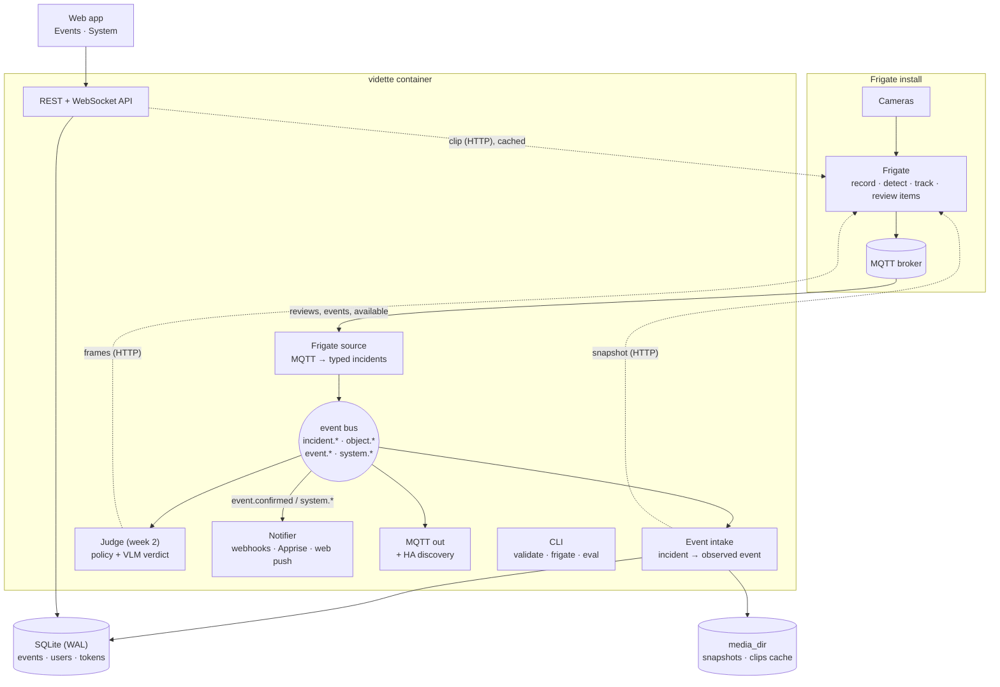

# Architecture overview

Since v0.2 Vidette is an **intent layer on top of Frigate**
([ADR-0009](adr/0009-intent-layer-over-frigate.md)): one small Python service beside an
existing Frigate and its MQTT broker. Frigate owns cameras, recording, detection and review
items; Vidette owns the decision of which incidents deserve a person's attention, and the
measurement of how good that decision is. The v0.1 NVR architecture (go2rtc sidecar,
recorder, detection cascade) is frozen at tag `nvr-core`.



## Components

| Component | Role | Code | Status |
|---|---|---|---|
| **Frigate source** | Subscribes to `<prefix>/reviews`, `/events`, `/available`; parses leniently; filters by camera and severity; publishes `incident.*` / `object.*`. [frigate.md](../frigate.md) | `vidette/frigate/source.py` | ✅ |
| **Frigate client** | Read-only HTTP: review items, event snapshots, recording frames, clips. | `vidette/frigate/client.py` | ✅ |
| **Incident model** | Source-agnostic `Incident` / `TrackedObject`; the same type `vidette eval` builds from labels. | `vidette/core/incidents.py` | ✅ |
| **Event intake** | One `observed` event per incident; snapshot cache; `event.observed` for live UIs. | `vidette/events/intake.py` | ✅ |
| **Judges** | `Judge` interface; baselines today, the VLM judge in week 2. | `vidette/verdicts/` | ✅ interface · 📐 VLM |
| **Evaluation** | Dataset format, metrics with intervals, cost projection. [eval.md](../eval.md) | `vidette/eval/` | ✅ |
| **Notifier** | Signed webhooks, Apprise, web push; `event.observed` never notifies. | `vidette/notify/` | ✅ |
| **MQTT out** | Vidette's own events to a broker, Home Assistant discovery. | `vidette/notify/mqtt.py` | ✅ |
| **API + web app** | Auth, events, push, system, metrics, WebSocket; Events and System pages. [api.md](../api.md) | `vidette/api/`, `web/` | ✅ |
| **Store** | SQLite WAL, append-only migrations. [ADR-0008](adr/0008-database.md) | `vidette/db/` | ✅ |

## Containment rules (unchanged in spirit)

- Every worker (source, intake, notifier, MQTT) catches its own failures, reports them as
  rate-limited system events and keeps running. Frigate or the broker being down never
  blocks boot or the API.
- Every queue on the bus is bounded; drops are counted in `vidette_bus_dropped_total`.
- Nothing is confirmed, so nothing notifies, without a verdict. Incidents travel on
  internal topics (`incident.*`) that no notification rule can match, and `event.observed`
  is dropped by the dispatcher by rule.
- Vidette never writes to Frigate.

## Runtime layout

```
/config/vidette.yaml                       # your config (env-interpolated, validated on boot)
/config/vidette.db                         # SQLite (WAL): events, users, tokens, push subscriptions
/media/vidette/<camera>/events/<id>/snapshot.jpeg   # cached from Frigate
/media/vidette/clips/<id>.mp4                       # fetched from Frigate on first request
```

## Network surface

| Port | What | Exposure guidance |
|---|---|---|
| 8642/tcp | Vidette UI + API | LAN or VPN only; TLS via your reverse proxy if exposed |
| outbound | Frigate API (usually :5000) and the MQTT broker | compose network; never publish Frigate's port 5000 |

Full guidance: [security-model.md](security-model.md).

## What Vidette deliberately is not

- **Not an NVR** any more: no recording, decoding, detection or camera adapters on this line.
- **Not a distributed system**: one process, SQLite until a real deployment proves it
  insufficient.
- **Not a home-automation hub**: Home Assistant and MQTT are integrations.
